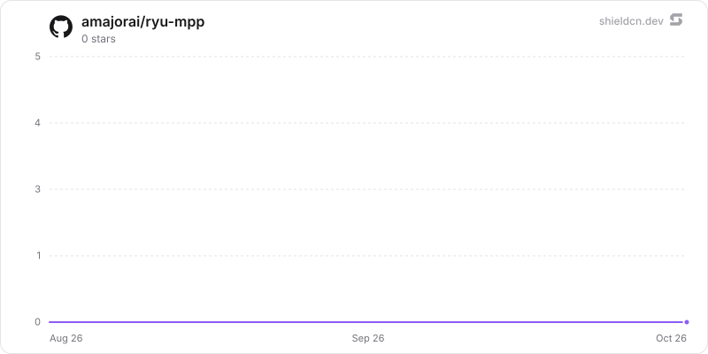

<div align="center">

# mpp

</div>

Governed machine payments: discover MPP services, enforce per-request and daily budgets, approve exact charges, and retain safe receipts.

> **The public home of `ryu-mpp`.** Source, builds, and releases live here —
> binaries for every platform are attached to each release.
>
> This tree is generated from the Ryu monorepo, so commits pushed here
> directly are replaced on the next sync. **Pull requests are welcome** —
> open them here and they are ported into the monorepo, then flow back out.
> Ryu as a whole: https://github.com/amajorai/ryu

## Install

**App:** [Install](ryu://apps/com.ryu.mpp) (opens the Ryu desktop app and asks you to confirm)

**CLI:**

```bash
ryu apps add com.ryu.mpp
```

## Source & build

The **source of record** for this app: a Bun/TypeScript
`sidecar/` Ryu runs locally as a grant-gated control capability, plus the
manifest `ui/`. The sidecar builds standalone — `cd sidecar && bun install &&
bun run build` compiles a single `ryu-mpp` executable; each release attaches
the per-platform binaries.

## License

Apache-2.0 — see [LICENSE](./LICENSE).

## What it adds

- A **Payments** companion surface.
- Agent tools to search MPP services, check the wallet and budget, prepare a
  request or paid MCP tool call, approve and pay a prepared request, and list or
  read receipts.
- The `ryu-mpp` local sidecar, mounted at `/api/mpp`.

Signing keys use Ryu's per-app encrypted custody and never enter chat, app
state, logs, or receipt records. Payments require explicit approval.

## At rest

Wallet signing keys and the server secret stay sealed through Core (`CoreSecretVault`, host
`crypto.seal`). The payment history in `mpp.db` is sealed by the sidecar with the `@ryu/mpp`
plugin subkey (`encb:v1:`, ChaCha20-Poly1305, store `mpp.db`, AAD bound to the row id):
`origin` and `payee` in `payment_reservations` and `origin`, `payee` and `reference` in
`payment_receipts`. Amounts, currencies, chain ids, challenge ids and hashes, idempotency
keys, statuses and timestamps stay plaintext (budget sums, replay checks and ordering query
them), as do the SDK's `mppx_kv` replay markers (expiry and type only) and the budget policy. The
settlement `reference` arrives after the payment is made, so it is never refused: under an
older Core (compat mode) a reference that looks like a Ryu envelope (`encb:v<n>:`) is stored
behind a `ryu-escaped:` prefix that reads strip.

The key is captured at startup (`capturePluginKeys`; the manifest already grants
`crypto:seal`). Existing plaintext rows are sealed on open (cursor pagination,
compare-and-swap, resumable, idempotent), then the WAL is truncated and the database
compacted when disk space allows. A receipt that does not open is skipped in lists and
counted (`sealing.unreadableRows` in `/api/mpp/status`); reading that receipt by id fails.
A store sealed under a different key refuses new payments (`503 sealing_unavailable`).
Under an older Core that delivers no key, a never-sealed ledger stays plaintext
(`sealing: "waiting for a Ryu update"`). Run standalone, the sidecar uses `RYU_MASTER_KEY`
or generates `<data dir>/secrets/standalone-root.key` (0600) and refuses a later different
key.

## Star History

<a href="https://github.com/amajorai/ryu-mpp/stargazers">
  <picture>
    <source media="(prefers-color-scheme: dark)" srcset="./.github/shieldcn/star-chart-dark.svg" />
    
  </picture>
</a>
